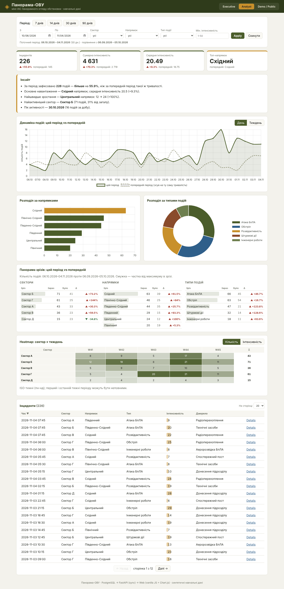

# Панорама-ОВУ

Міні-ІАС панорамного огляду обстановки (практичне завдання 5.8, **варіант 5**).
Архітектура: **PostgreSQL → FastAPI (sync, psycopg2, raw SQL) → Web (HTML/CSS/vanilla JS + Chart.js CDN)**. Без Docker, без async, без ORM. Дані — синтетичні навчальні (500 подій за 90 днів).

**Фокус варіанту:**
- агрегування **за кількома зрізами одночасно** — блок «Панорама зрізів» (сектори, напрямки, типи) і ендпоїнт `/panorama`;
- **швидке перемикання періодів** — кнопки 7 / 14 / 30 / 90 днів;
- порівняння **«цей період vs попередній»** — Δ% у KPI, пунктирна крива попереднього періоду на тренді, `/compare`;
- режим **demo/public без чутливих полів** — поле `source` не запитується з API (`public=true`) і не показується.



## Запуск за 3 хв

### Linux / macOS
```bash
python3 -m venv .venv && source .venv/bin/activate
pip install -r requirements.txt
cp .env.example .env                      # вкажіть USER і PASSWORD
psql -U postgres -c "CREATE DATABASE panorama_ovu;"
bash scripts/init_db.sh                   # схема db/schema.sql
bash scripts/seed_db.sh                   # 500 тестових записів
uvicorn api.main:app --reload             # API: http://localhost:8000 (Swagger: /docs)
# у другому терміналі:
cd web && python -m http.server 5500      # Web: http://localhost:5500/?view=analyst
# у третьому терміналі (перевірка):
bash scripts/smoke_test.sh
```

### Windows (PowerShell)
```powershell
python -m venv .venv; .\.venv\Scripts\Activate.ps1
pip install -r requirements.txt
Copy-Item .env.example .env               # вкажіть USER і PASSWORD
psql -U postgres -c "CREATE DATABASE panorama_ovu;"
.\scripts\init_db.ps1
.\scripts\seed_db.ps1
uvicorn api.main:app --reload
# у другому вікні:
cd web; python -m http.server 5500
# у третьому вікні:
.\scripts\smoke_test.ps1
```
> Якщо PowerShell блокує скрипти: `Set-ExecutionPolicy -Scope CurrentUser RemoteSigned`.
> `psql` має бути в `PATH` (зазвичай `C:\Program Files\PostgreSQL\16\bin`).

## Сценарій демонстрації (executive → analyst → demo)
1. `?view=executive` — керівник бачить лише 4 KPI з Δ% до попереднього періоду, тренд і автоматичний «Інсайт».
2. Кнопками **7 / 30 / 90 днів** показати, як миттєво змінюється період і база порівняння (рядок під фільтрами).
3. Перейти в `?view=analyst` (фільтри зберігаються в URL) — з'являються розподіли, панорама зрізів, heatmap і таблиця.
4. Обрати напрямок «Східний», мін. інтенсивність 20 → **Apply**: усі блоки оновлюються узгоджено.
5. У «Панорамі зрізів» знайти зріз із найбільшим Δ%, у heatmap — «гарячий» тиждень сектора.
6. У таблиці відсортувати за інтенсивністю, відкрити **Details** — модальне вікно з `/incidents/{id}`.
7. Перейти в `?view=demo` — таблиця прихована, з'являється банер; поле «Джерело» не запитується з API.
8. Висновок: одні дані — три подання для різних аудиторій.

## API
| Ендпоїнт | Відповідь |
|---|---|
| `GET /health` | `{status}` |
| `GET /filters` | `{sectors, directions, event_types, min_date, max_date}` |
| `GET /kpi` | `{total_incidents, total_intensity, avg_intensity, top_direction}` |
| `GET /trend?group=day\|week` | `[{t, value}]` (дні/тижні без подій = 0) |
| `GET /distribution/directions`, `/distribution/types` | `[{label, value, intensity}]` |
| `GET /heatmap?metric=count\|intensity` | `{columns, week_starts, rows:[{sector, values}]}` |
| `GET /incidents?page&page_size(5..100)&sort&order&public` | `{total, page, page_size, items}` |
| `GET /incidents/{id}?public` | повний запис (без `source`, якщо `public=true`) |
| `GET /compare` | KPI поточного й попереднього періодів + `delta_pct` |
| `GET /panorama` | зрізи sectors / directions / event_types: `current`, `previous`, `delta_pct` |

Усі аналітичні ендпоїнти приймають `from`, `to` (YYYY-MM-DD, включно), `sector`, `direction`, `event_type`, `min_intensity`. Валідація: неправильні дати та `from > to` → 400/422; `sort` — лише з білого списку колонок (захист від SQL-ін'єкцій); усі значення фільтрів передаються як параметри psycopg2.

## Структура
```text
db/       schema.sql, seed.py
api/      db.py (get_conn, autocommit), main.py (ендпоїнти)
web/      index.html, app.js (API_BASE_URL = "http://localhost:8000"), styles.css
scripts/  init_db.*, seed_db.*, smoke_test.* (+ smoke_test.py)
docs/     architecture.md, screenshots/
```
Детальніше — [docs/architecture.md](docs/architecture.md).
